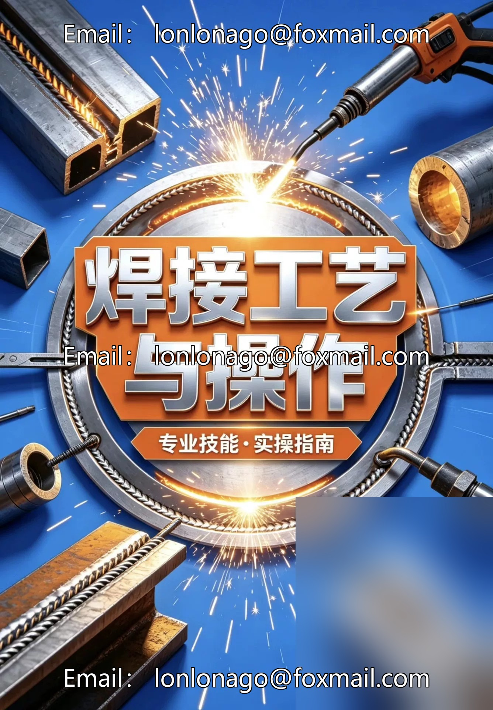
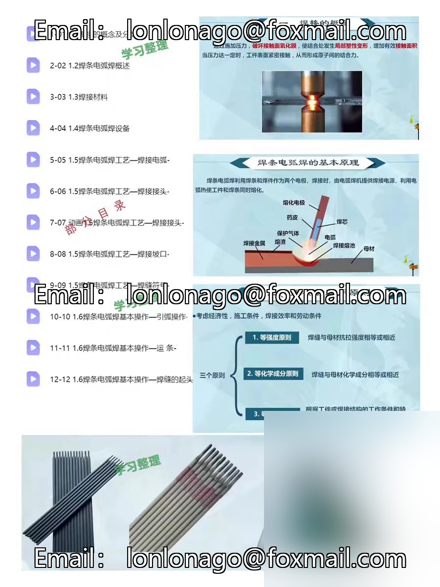
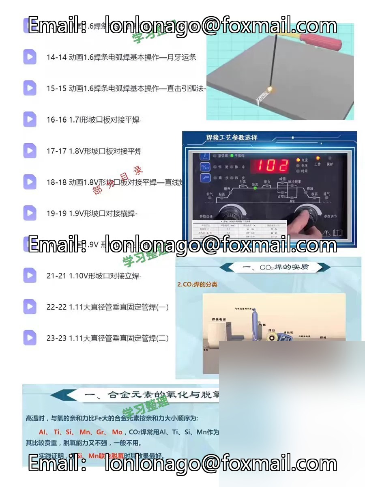
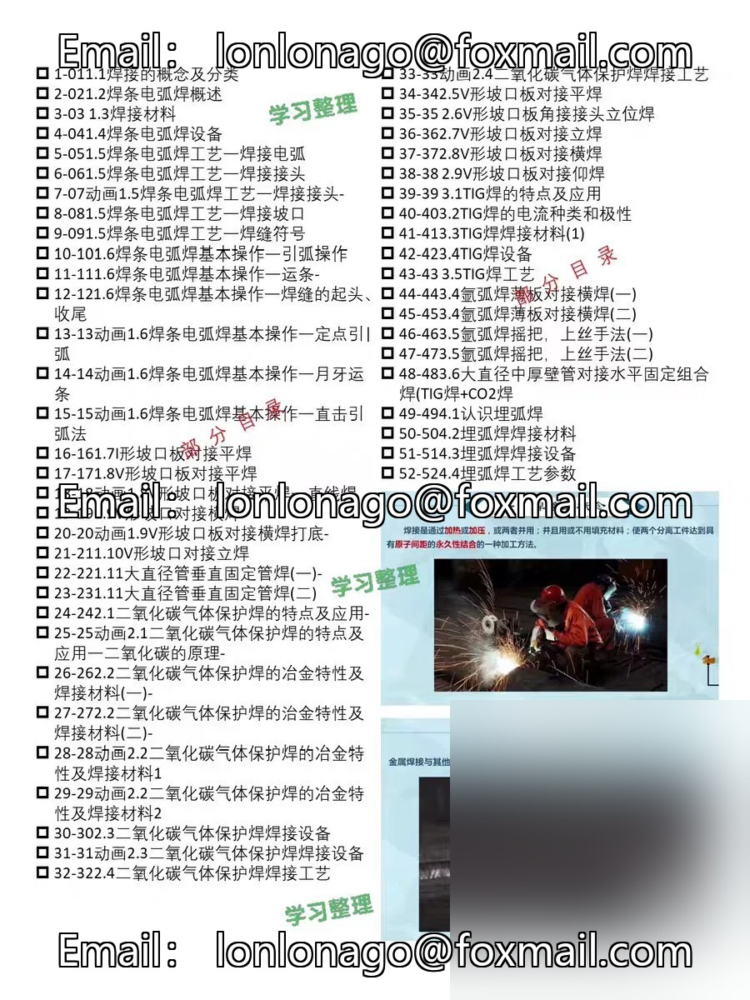
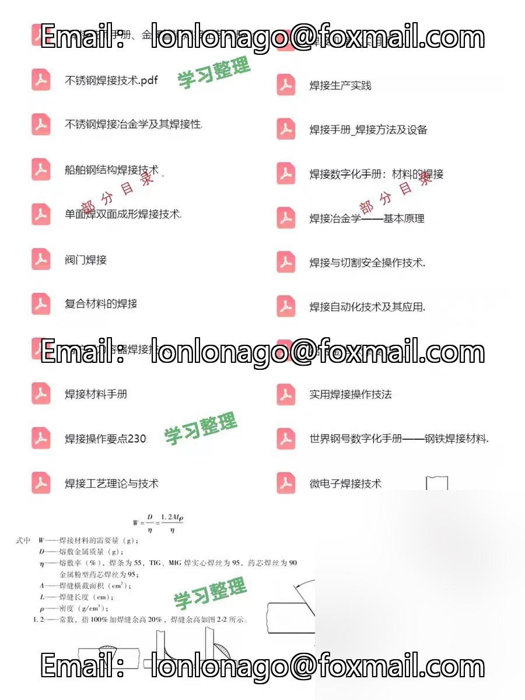

# Welding Process and Operation Learning Materials Collection

## Body

Welding Process and Operation Learning Materials Collection

179
Inclusive of welding technology and operation, the principle of arc, selection of welding rods, welding parameters, common welding methods (hand welding, CO2 welding, argon arc welding, etc.), as well as practical skills, suitable for welders, mechanical, metal processing learning, review, skill improvement

For learning and exchange only.

## Images

## Payment

Here is a pay link on Stripe ( https://buy.stripe.com/3cs8yP7sY87d0vu9AB ). Please contact me lonlonago@foxmail.com after funding $89, and I will send you a complete data files , thank you!

